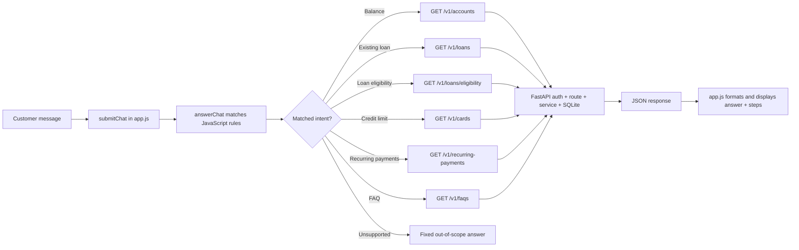

# Request lifecycle: how the banking chatbot works

This guide explains what executes when a person asks the app a question. The Markdown documents describe the system to people; the Python and JavaScript files execute it.

## The pieces

```text
Browser UI (HTML + JavaScript)
    │  HTTP request with the selected demo Bearer token
    ▼
FastAPI route (app/api)
    │  validates input, authenticates, selects the mode
    ├──────────────► Service + SQLite (app/services + app/db)
    │                 server-side rules and customer-scoped data
    │
    └──────────────► Ollama / Qwen (AI mode only)
                       selects from tools offered by the server
                       Python executes tool; the model never opens SQLite
```

These are separate jobs:

- **JavaScript** collects the message, adds the active profile token, sends `fetch()`, and displays the answer and **Steps**.
- **FastAPI** receives HTTP requests, checks identity, validates the request and response shapes, and calls Python functions.
- **Service functions** contain banking rules and SQL queries.
- **SQLite** stores demo customer and banking rows in `data/banking.sqlite3`.
- **Ollama/Qwen** generates text and, in banking mode, can request a named function call from a limited list. It does not receive a database connection.

## AI banking question: request path

```mermaid
sequenceDiagram
    actor Customer
    participant UI as Browser app.js
    participant API as FastAPI /v1/learning/llm
    participant Auth as current_customer_id
    participant Chat as llm_lesson_service
    participant Qwen as Ollama Qwen
    participant Tool as banking_tools.execute_tool
    participant Service as Banking service
    participant DB as SQLite

    Customer->>UI: Ask a banking question
    UI->>API: POST message + mode=banking_chat + Bearer token
    API->>Auth: Validate selected profile token
    Auth-->>API: trusted customer_id
    API->>Chat: message + trusted customer_id + request-local DB connection
    Chat->>Chat: reject foreign IDs/names; check supported scope
    Chat->>Chat: _tools_for_message picks the allowed tool list
    Chat->>Qwen: message + instructions + only allowed tool schemas
    Qwen-->>Chat: text or a structured function call
    Chat->>Tool: execute allow-listed function with trusted customer_id
    Tool->>Service: call service function
    Service->>DB: parameterized, customer-scoped SQL
    DB-->>Service: rows / rule inputs
    Service-->>Tool: verified result
    Tool-->>Chat: result + trace step
    alt precise one-tool answer (name, credit limit, loan result)
        Chat->>Chat: format answer from verified fields; skip another model request
    else answer needs model synthesis
        Chat->>Qwen: tool result in the next bounded model round
        Qwen-->>Chat: final response text
    end
    Chat-->>API: answer + model + steps (+ optional action)
    API-->>UI: JSON response
    UI-->>Customer: answer and expandable Steps
```

## Example: “I need a loan”

1. The AI form handler `submitAiChat()` in `app/web/app.js` calls `answerWithQwen()`.
2. `answerWithQwen()` calls the browser helper `api()` with `POST /v1/learning/llm`, a JSON body like `{"message":"I need a loan","mode":"banking_chat"}`, and `Authorization: Bearer <selected token>`.
3. `LLMMessageRequest` in `app/schemas/llm_lesson.py` checks the message length and restricts `mode` to `lesson` or `banking_chat`.
4. FastAPI's `current_customer_id()` in `app/core/security.py` compares the bearer token against the demo token map in `app/config.py`. It returns a trusted customer ID such as `CUST-1001`. No customer ID from the message is used as authority.
5. `app/api/llm_lesson.py` sees `mode == "banking_chat"`, opens a request-local SQLite connection, and calls `answer_banking_chat()`.
6. The service rejects customer IDs and names belonging to another demo profile before asking the model. Unsupported requests also get a fixed response here.
7. `_tools_for_message()` recognizes “need” + “loan” as an eligibility request. It gives Qwen only the `check_loan_eligibility` function schema for this request.
8. Qwen returns a function-call request. `execute_tool()` dispatches that exact allow-listed function, passing the trusted customer ID that came from authentication.
9. `loan_service.eligibility()` runs SQL scoped to that customer and applies the demo rule: an active loan means “not eligible”; otherwise it returns an indicative demo offer. The rule is not underwriting.
10. For this one-tool loan response, `_format_verified_answer()` builds a short answer from the verified result. This skips a second Qwen request and prevents Qwen from changing the eligibility result.
11. FastAPI serializes `answer`, `model`, `steps`, and optional `action` using `LLMMessageResponse`. `app.js` adds the answer and the trace steps to the AI transcript.

For Alex (`CUST-1001`), the seed data contains an active personal loan, so the demo rule returns “not eligible for the demo loan offer.” The response is not a real credit decision.

## What makes it secure (and what does not)

### The reliable boundary

- The browser sends a token; the server resolves it to a customer ID.
- Private service functions receive that server-resolved ID.
- Queries filter on `customer_id = ?` using SQL parameters.
- Function schemas do not ask Qwen to provide a customer ID.
- `execute_tool()` is a Python allow-list. A model response cannot name and execute arbitrary Python code.
- The AI service exposes only tools `_tools_for_message()` has allowed for that current request.
- For sensitive one-tool results such as a customer name, credit limit, or loan eligibility, Python formats the final answer from verified data rather than letting Qwen rewrite the value.
- The only write is a limit increase review request. It requires a separate customer click and card ownership is checked again by the write endpoint.

### The probabilistic part

Qwen can choose the wrong supplied tool, misunderstand a question, or fail to produce a tool call. The server withholds a banking answer if its required tool did not run. The model is not responsible for identity, database authorization, or eligibility logic. For multi-part requests whose response needs synthesis, Qwen writes the final wording from the tool results; that prose can still be imperfect.

This project has no RAG pipeline, vector database, document chunking, or embeddings. FAQ lookup is a normal SQLite `LIKE` search implemented in `faq_service.py`. It is retrieval, but not RAG. There is no agent framework; the app contains a small, hand-written function-calling loop bounded to five model rounds.

## The deterministic panel

The rule panel follows a different path and does not call Qwen:



`answerChat()` is a small set of explicit JavaScript regular-expression rules. For example, an account/balance phrase calls `/v1/accounts`; a card-limit phrase calls `/v1/cards`. If no rule matches, it returns “That isn’t something I can help with” without calling the banking API.

## API reference in plain English

| API | What it means | Who calls it |
| --- | --- | --- |
| `GET /health` | Is the FastAPI process alive? | Browser, monitor, or developer |
| `GET /v1/auth/me` | Which demo profile does this bearer token represent? | Dashboard startup/profile-name rule |
| `GET /v1/auth/demo-profiles` | Fictional names/IDs used to label the local profile selector; no account data | Dashboard only; bearer token required |
| `GET /v1/accounts` | List the selected user's accounts and balances | Dashboard and deterministic chat |
| `GET /v1/accounts/{account_id}` | Read one account, only if it belongs to the selected user | API client |
| `GET /v1/accounts/{account_id}/transactions` | Read that owned account's transactions | Dashboard transaction button |
| `GET /v1/loans` | List the selected user's loan records | Dashboard and deterministic chat |
| `GET /v1/loans/eligibility` | Apply the demo active-loan rule | Dashboard and deterministic chat |
| `GET /v1/cards` | Read the selected user's cards, limits, and available credit | Dashboard and deterministic chat |
| `GET /v1/cards/eligibility` | Apply the demo active-card rule | Dashboard and deterministic chat |
| `POST /v1/cards/limit-increase-requests` | Store a limit request for review; does not change the limit | Limit form or AI confirmation button |
| `GET /v1/recurring-payments` | List the selected user's scheduled payments | Dashboard and deterministic chat |
| `GET /v1/faqs?q=...` | Search public FAQ rows | Dashboard and deterministic chat |
| `POST /v1/learning/llm` | Existing authenticated model endpoint; `lesson` by default or `banking_chat` for the AI panel | AI panel or `/docs` |

An **API route** is the HTTP entry point in `app/api/*.py`. It does not usually contain the business rule itself: it validates inputs, gets dependencies, calls a service, and returns JSON.

## The one write: credit limit increase

```text
Customer asks to increase limit
  -> Qwen may prepare a proposal (no database write)
  -> UI shows a confirm button
  -> customer clicks it
  -> POST /v1/cards/limit-increase-requests
  -> LimitIncreaseRequest validates card ID and positive new limit in cents
  -> current_customer_id supplies the trusted owner
  -> review_service verifies active card ownership and new limit > current limit
  -> computes increase = requested - current
  -> compares increase with SELF_SERVICE_LIMIT_INCREASE_MAX (default EUR 1,000)
  -> inserts one limit_increase_requests row
  -> returns 202 + status + whether human follow-up is required
```

When the increase is above the threshold the status is `pending_human_review`. “A bank representative will call” is demo response text only: this project does not place a phone call or notify a real employee. The card's actual limit remains unchanged.

## Where to look in the repository

| Area | Files | Responsibility |
| --- | --- | --- |
| App setup | `app/main.py` | Creates FastAPI, registers routes, starts/closes SQLite, seeds data, warms Qwen |
| Settings | `app/config.py`, `.env` | Database URL, token map, Ollama URL/model, timeouts, human-review threshold |
| UI | `app/web/index.html`, `app/web/app.js`, `app/web/styles.css` | Dashboard, profile switcher, both chats, active-token header, request forms, visible trace |
| HTTP routes | `app/api/*.py` | API paths, request dependencies, calls into services |
| Authentication | `app/core/security.py` | Validates demo bearer token and resolves customer identity |
| Authorization | `app/core/permissions.py` | Checks record ownership for ID-based reads |
| Request/response validation | `app/schemas/*.py` | Pydantic models validate JSON fields and output shapes |
| Banking functions | `app/services/*_service.py` | Customer-scoped SQL and demo business rules |
| AI tool definitions/dispatch | `app/services/banking_tools.py` | Tool schemas Qwen can see and allow-listed Python function dispatch |
| AI orchestration | `app/services/llm_lesson_service.py` | Warm-up, plain lesson call, scope checks, tool loop, traces, precise response formatting |
| Database schema/seed | `app/db/database.py`, `app/db/seed.py` | SQLite tables, indexes, generated demo names and fictional records |
| Domain types | `app/models/*.py` | `TypedDict` descriptions for records; these are not ORM database models |
| Tests | `tests/*.py` | Regression checks for identity, ownership, tool flow, seeding, and concurrent reads |
| Human docs | `docs/*.md`, `README.md` | Explanations only; FastAPI does not execute Markdown documents |

## Model configuration and warm-up

`app/config.py` reads these settings from `.env`:

- `LLM_BASE_URL=http://localhost:11434/v1`
- `LLM_MODEL=qwen3.5:0.8b`
- `LLM_API_KEY=ollama` (placeholder accepted by local Ollama)
- `LLM_TIMEOUT_SECONDS=120`
- `LLM_WARMUP_ENABLED=true`

During FastAPI startup, `app/main.py` runs the lifespan function. It initializes and seeds SQLite, then calls `warm_up_model()` with the harmless static prompt “Reply with OK.” No customer data is included. A warm-up failure is logged but does not prevent app startup.

The default `POST /v1/learning/llm` mode is `lesson`: one plain Responses API call, no tools, no bank data. The AI panel sends `mode: "banking_chat"`, which uses Ollama's OpenAI-compatible Chat Completions function-calling format. The same URL and model setting are used, but these are separate execution paths inside one FastAPI endpoint.

## How to explain the project aloud

> “The browser sends a message and the selected demo bearer token to FastAPI. FastAPI maps the token to a server-side customer ID before any private lookup. The deterministic chat uses explicit rules and ordinary banking APIs. The AI chat uses the existing LLM route: backend rules narrow the available tools, Qwen can request one of those tools, and Python executes it with the authenticated customer ID. SQLite and service functions—not the model—enforce ownership and banking rules. For sensitive single-field answers, Python formats the final response from verified data. The limit request is the only write and requires a customer confirmation.”
